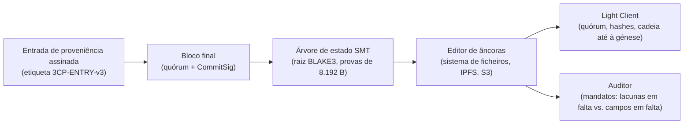

# 3CP segundo a SPEC-3CP-V3: consenso, cadeia de custódia e casos de uso

*Estudo generalista do protocolo a partir da sua especificação*

Outubro de 2026 | Ensaio técnico

*Lido a partir da SPEC-3CP-V3, o 3CP organiza-se em duas peças, um consenso BFT em duas fases que converte acontecimentos submetidos em blocos finais assinados por quórum, e uma cadeia de custódia criptográfica que conserva esses blocos e os expõe a verificação independente, e a maior parte das suas opções de desenho explica-se pelo que impedem a uma entidade auditada que controla a própria infraestrutura, que é omitir, alterar ou reconstruir retroativamente a evidência.*

## 1. Âmbito e método

Este artigo descreve o 3CP (Cryptographic Chain-of-Custody Protocol) a partir do texto da SPEC-3CP-V3, versão 3.0.0, datada de 11 de outubro de 2026 e marcada como normativa [1]. A especificação está em rascunho de pré-publicação e foi validada por uma suite de conformance estendida executada contra a implementação de referência; a própria spec reconhece, em nota não normativa (§16), que ainda não existe uma segunda implementação independente a demonstrar interoperabilidade, e que até existir a especificação pode conter casos limite não testados.

A v3.0 não responde a requisitos novos: substitui e consolida três drafts do v2.0 que coexistiam divergentes (dois na pasta spec e um interno), discordantes no tratamento da chave CBOR reservada e na construção da VRF. A consolidação resolve cada divergência a favor do que a spec chama o cânone criptográfico (§1.1): ou se adota a norma publicada, ou se documenta, estreita e explicitamente, uma divergência, com procedimento byte a byte e vetores de teste. A v1.0 (spec/3CP.md) fica preservada apenas como referência histórica, e o Apêndice C lista vinte e duas alterações face ao v2.0, a maior parte correções de conformidade com as normas citadas.

As referências a secções (§) dizem respeito à SPEC-3CP-V3, cujo texto é a única fonte normativa usada. As restantes normas — FIPS 203, FIPS 204, os RFC e a suíte vrf-r255 — figuram aqui porque a própria spec as nomeia, e servem para situar os mecanismos, sem terem sido analisados à parte. As implementações de referência, Gleipnir (Go) e CARCOSA (Rust), vivem em repositórios separados e não fazem parte da especificação; o texto declara-se suficiente para uma implementação independente alcançar interoperabilidade plena sem acesso ao código de referência. Os casos de uso, por seu lado, não descrevem produtos concretos, relacionam necessidades de uma implantação com o mecanismo da spec que lhes responde.

O estudo segue a ordem lógica de um registo de evidência: das propriedades pretendidas ao ciclo de consenso, ao formato dos blocos, ao estado e às provas, aos mandatos, terminando na verificação por terceiros, nos casos de uso e nos limites que a própria spec reconhece.

## 2. O que o 3CP promete e o que deixa ao operador

O princípio que abre a spec é que a conformance não pode depender da boa-fé da entidade auditada (§1.1). O 3CP é um protocolo da camada de aplicação para produzir, preservar e verificar evidência de cadeia de custódia: qualquer parte — regulador, auditor, consumidor, verificador externo — pode verificar que um artefacto existiu num dado momento, que a sua proveniência foi atestada por identidades conhecidas e que nenhuma reconstrução retroativa dos acontecimentos é possível sem deteção. A spec é deliberadamente agnóstica: nada diz sobre linguagem de implementação, sistema operativo ou bibliotecas criptográficas.

O protocolo reconhece cinco entidades (§2.1): o submissor, que entrega entradas de proveniência e não precisa de ser validador; o validador, que participa no consenso com um par de chaves ML-DSA-65 e um par de chaves VRF; o editor de âncoras (Anchor Publisher), que publica blocos finais em armazenamento publicamente legível; o Light Client, que verifica blocos e provas sem manter estado completo; e o auditor, que verifica conformance de mandatos contra a cadeia. O modelo de ameaças (§2.2) enumera cinco adversários: o adversário de rede (A1), que observa, atrasa ou reordena mensagens; o operador comprometido (A2), que controla a infraestrutura de nós, mas menos que o quórum; o submissor comprometido (A3), que pode submeter entradas falsas mas não forjar assinaturas de validadores; o adversário externo (A4), sem acesso a chaves, que pode tentar negação de serviço ou repetição; e o adversário quântico (A5), que a v3.0 enfrenta com primitivas pós-quânticas do NIST.

As propriedades pretendidas resumem-se na Tabela 1, com os mecanismos que as realizam e os limites que a própria spec declara.

**Tabela 1. Propriedades da cadeia de custódia e mecanismos que as realizam.**

| **Propriedade** | **O que a spec estabelece** | **Mecanismo** | **Limite declarado** |
|---|---|---|---|
| Integridade das entradas | Cada entrada ancorada é verificável por inclusão na árvore de estado | SMT BLAKE3-256, provas de inclusão e de ausência (§9) | O conteúdo das entradas é público; pré-imagens sensíveis têm de ser protegidas antes da submissão (§17) |
| Não-repúdio | Nenhuma parte pode negar a submissão validada por quórum | Assinaturas ML-DSA-65 do quórum sobre H(B) (§5.4, §6.2) | A custódia das chaves é responsabilidade do operador; garantias nulas se as chaves coexistirem com as credenciais que deviam limitar (§17) |
| Finalidade por ciclo | Um ciclo produz zero ou um bloco final, imutável e irreversível | PREPARE/COMMIT com quórum ceil(2N/3) (§6.1, §6.3) | Um quórum pode censurar abortando ciclos; a ausência de blocos é detetável, não impedível (§17) |
| Verificação por terceiros | Qualquer parte com a cadeia pública verifica quórum, assinaturas e hashes sem contactar a rede produtora | Light Client e Anchor Publishers (§12) | O conjunto de validadores tem de vir de uma âncora de confiança externa ao bloco verificado (§5.1, §13.4) |
| Detetabilidade da omissão | Uma obrigação de registo declarada torna a entrada em falta verificável por terceiros | Mandatos assinados, versionados e ancorados (§13) | Um acontecimento nunca submetido não é visto pelo protocolo; só a omissão face a uma obrigação declarada é detetável (§13.3) |
| Resistência pós-quântica | Assinaturas e encapsulamento resistem a um adversário quântico (A5) | ML-DSA-65 e ML-KEM-1024 (§3.2, §3.4) | Assumem-se ainda colisões BLAKE3 e pré-imagens SHA-256 clássicas (§2.2, §17) |

Duas peças realizam estas propriedades. O consenso (§6) transforma entradas submetidas em blocos finais com assinaturas de quórum, e a cadeia (§5, §9, §12) liga os blocos, agrega o estado numa árvore e o publica. A spec deixa deliberadamente fora do protocolo o que compete ao operador: o controlo de acessos, a proteção de pré-imagens e a separação de custódia das chaves (§17).

## 3. O ciclo de consenso

### 3.1 Ciclos, eleição de líder e proposta

O ciclo é a unidade atómica de tempo: cada ciclo produz zero ou um bloco final do índice correspondente, e divide-se em duas fases atómicas, PREPARE e COMMIT (§6.1). A duração do ciclo é adaptativa, a soma de um intervalo base (por omissão 3 s) com a média móvel do RTT multiplicada por um fator de segurança (por omissão 1,5), com um limite máximo de 10 s (§10.1) — valores configuráveis por mandato. A duração nunca foi trivial: a v2.0 portuguesa escrevia os limites em milissegundos, um erro de unidade que a v3.0 corrige, porque um ciclo de consenso com assinaturas ML-DSA e difusão entre pares é inviável abaixo de um segundo (Apêndice D8).

O líder de cada ciclo é eleito por função aleatória verificável (VRF) sobre uma entrada fixada no início do ciclo: alpha_c, composta pela etiqueta de domínio, o índice do ciclo em little-endian e a raiz de estado antes de qualquer inserção do ciclo (§6.2). Cada validador publica a sua prova; a prova é verificada contra a chave VRF do conjunto canónico de validadores, nunca contra estado local (§3.3, §7.2), e vence o validador com o Gamma lexicograficamente menor, desempatado pelo menor ValidatorID. O bloco candidato proposto pelo líder transporta o índice do ciclo, o hash do bloco anterior, a raiz de estado após inserir as entradas pendentes, o conjunto canónico de validadores com as suas chaves ML-DSA-65 e VRF, a configuração de quórum e um valor Lambda1 (o autovalor de Fiedler da topologia de rede, §5.1), que os validadores comparam com um mínimo quando aplicável.

### 3.2 PREPARE, COMMIT e o bloco final

Cada validador que aceita a proposta verifica cinco condições (§6.2): o hash do bloco anterior coincide com o aceite localmente, a raiz de estado é a que ele próprio recalcula ao inserir as entradas na mesma ordem, cada entrada passa a validação de §6.7, o Lambda1 respeita o mínimo e a versão do protocolo é 3. Se tudo passa, assina H(B) com ML-DSA-65 e difunde a assinatura PREPARE. O líder junta assinaturas até ao quórum ceil(2N/3); se não o atingir dentro do tempo do ciclo, o ciclo aborta sem bloco, as entradas ficam pendentes e o ciclo seguinte começa com eleição nova (§6.4). As entradas pendentes nunca são descartadas por expiração de ciclo, mas a sua permanência acima de cem ciclos é recusada (§10.2), e um ciclo sem entradas pode ser saltado por configuração (§10.3).

O bloco final constrói-se com o bitmap e o conjunto de assinaturas PREPARE, mais a assinatura de COMMIT do líder (§6.3). A construção separa compromissos: as assinaturas PREPARE cobrem H(B), o bloco até à chave 12, e a CommitSig cobre o bloco final incluindo as chaves 13 e 14 mas excluindo-se a si própria (§5.6) — precisamente para eliminar a circularidade da definição da v2.0, em que a assinatura se definia sobre um pré-conceito que a continha (Apêndice D5). Na difusão, cada validador confirma a população de bits do bitmap contra o número de assinaturas, cada assinatura contra o validador indicado pela sua posição de bit, e a CommitSig contra o proponente.

```mermaid
sequenceDiagram
    participant S as Submissor
    participant L as Líder (eleito por VRF)
    participant V as Validadores (quórum ceil(2N/3))
    Note over L,V: Ciclo c — alpha_c fixado no início do ciclo
    V->>V: prova ECVRF sobre alpha_c; vence o menor Gamma
    S->>L: entradas pendentes E (validação por §6.7)
    L->>V: proposta B (Index=c, PrevHash, StateRoot, E, Lambda1)
    V->>V: PrevHash, StateRoot, entradas, Lambda1, versão
    V->>L: PREPARE — assinatura ML-DSA-65 sobre H(B)
    alt quórum dentro do tempo do ciclo
        L->>V: B_final = B + bitmap + assinaturas + CommitSig
        V->>V: bloco final aceite (imutável, irreversível)
    else tempo esgotado
        Note over L,V: ciclo abortado — sem bloco; E mantém-se pendente
    end
```

**Figura 1.** O ciclo de consenso em duas fases (adaptado de §6). As assinaturas PREPARE cobrem H(B) (chaves 0–12) e a CommitSig cobre o bloco final excluindo a própria chave 15 (§5.6): compromissos distintos, sem sobreposição.

### 3.3 Modos de operação

O protocolo admite três configurações, resumidas na Tabela 2. O modo degradado é o ponto mais sensível: com menos de quatro validadores, o quórum passa a uma assinatura, e cada bloco degradado é obrigado a assinalar-se nos metadados, para que qualquer terceiro o distinga de um bloco respaldado por quórum (§6.5). A spec é explícita: o modo degradado é uma configuração de confiança em chave única, sem tolerância bizantina, e não pode sustentar não-repúdio contra uma chave comprometida. A saída exige quatro validadores e dez ciclos consecutivos de quórum normal.

**Tabela 2. Modos de operação (§6.1, §6.5, §10.3).**

| **Modo** | **Condições** | **Quórum** | **Consequências** |
|---|---|---|---|
| BFT completo | N ≥ 4 validadores | ceil(2N/3) assinaturas PREPARE | Bloco final imutável com não-repúdio de quórum |
| Degradado | N < 4 validadores | 1 assinatura | Confiança em chave única, sem BFT; blocos marcados com `3cp:degraded-block` nos metadados |
| Ciclo vazio | Sem entradas pendentes, se configurado | — | Ciclo saltado sem bloco |

Um líder bizantino que proponha dois blocos para o mesmo ciclo produz evidência criptográfica de si próprio: dois blocos distintos do mesmo índice com CommitSig válidas sobre cada. Qualquer validador pode submeter esse par como entrada de proveniência com a etiqueta `3cp:slash-evidence:v1` (§6.6) — a evidência de má-fé entra na cadeia que ela própria compromete.

## 4. Formato dos blocos e codificação canónica

Toda a serialização do 3CP é CBOR canónico, segundo os requisitos de codificação determinística do RFC 8949 (§4.1): chaves ordenadas pela sua representação codificada, inteiros na forma mais curta de ida e volta, valores em vírgula flutuante na mais estreita das representações bin16, bin32 ou bin64 que represente o valor exatamente, comprimentos definidos, e NaN e infinito proibidos em qualquer parte. A regra dos flutuantes não é um capricho: a v1.0 e a v2.0 mandavam floats de 64 bits fixos, o que produz uma cadeia de bytes diferente da canónica e, portanto, um BlockHash diferente — e um par que descodifique e recodifique canonicamente tem de obter bytes idênticos (Apêndice D2).

Cada estrutura autenticada começa por uma etiqueta de domínio em ASCII fixo (§4.2): `3CP-BLOCKHASH-v3` no pré-conceito do hash do bloco, `3CP-SMT-LEAF-v3` e `3CP-SMT-NODE-v3` na árvore, `3CP-MANDATE-v3` nos mandatos, `3CP-ENTRY-v3` nas entradas e `3CP-KEYROT-v3` na rotação de chaves. A etiqueta impede que o pré-conceito de uma estrutura seja prefixo ou igual ao de outra, fechando confusões entre estruturas e versões que partilham disposição de campos.

O bloco (§5.1) usa vinte chaves inteiras em ordem crescente, com tamanhos exatos: o conjunto de validadores viaja no próprio bloco como estrutura autodescritiva com as chaves ML-DSA-65 e VRF de cada validador; a versão do protocolo tem de ser 3; e as assinaturas PREPARE vivem exclusivamente nas chaves 13 (bitmap) e 14 (payload). A chave 8, que na v1.0 carregava assinaturas indiferenciadas e nos drafts da v2.0 mudava de significado conforme a versão, fica reservada e nula, e um bloco que a transporte com valor não nulo é recusado (§5.2) — o significado dos campos deixa de depender da versão. A extensibilidade é explícita: um descodificador tem de ignorar chaves acima de 19 e não pode recusar um bloco por transportar chaves desconhecidas (§5.3), a regra de robustez que o RFC 9413 recomenda.

O BlockHash (§5.5) é um SHA-256 sobre um pré-conceito com etiqueta de domínio, índice, hash anterior, raiz de estado, proponente, hash das entradas ancoradas, carimbo temporal e configuração de quórum canónica. A ligação do NetworkID (§11.1) ao pré-conceito prende cada bloco à sua génese e impede a repetição entre redes do hash de um bloco. A validação das entradas na admissão (§6.7) recusa hashes nulos, submissores vazios, etiquetas acima de 1024 bytes, assinaturas inválidas ou desproporcionadas, identidades não reconhecidas, excedentes de cadência e referências a mandatos desconhecidos, inativos ou expirados.

## 5. Estado, provas e verificabilidade por terceiros

O estado agregado é uma Sparse Merkle Tree de profundidade 256 sobre BLAKE3 (§9): folhas e nós internos com etiquetas de domínio próprias, seleção de caminho pelo bit menos significativo de cada byte da chave e provas de exatamente 256 irmãos de 32 bytes, 8.192 bytes no total, ordenadas da folha à raiz. Uma prova de ausência tem de recomputar até à raiz de estado corrente, e a função de verificação está escrita na própria spec (§9.3). Às etiquetas de domínio acresce a correção face às versões antigas, cujas folhas e nós sem separação permitiam confusão de segundas pré-imagens entre as três codificações (§9.1).

A identidade e a génese fecham-se por construção ordenada (§11.1): o NetworkID é o BLAKE3 do CBOR canónico do bloco de génese com a chave 11 omitida, e só depois se calcula o BlockHash sobre esse NetworkID. A ordem é normativa porque a definição da v2.0 — NetworkID como hash da génese, e hash da génese a ligar o NetworkID — era um ponto fixo sem solução (Apêndice D11). A semente de identidade UID0 deriva por HKDF-SHA256 com comprimento de saída fixo a 32 bytes, sal NetworkID e informação de domínio `3CP-UID0-v3`, a partir de uma entrada de 32 bytes do gerador aleatório do sistema (§11.2) — substituindo o requisito da v2.0 de recusar entradas com «entropia estimada abaixo de 80 bits», que a v3.0 elimina por não ser testável: uma implementação não pode medir a entropia de um tampão de bytes (Apêndice D7).

A rotação de chaves é uma entrada nativa do protocolo (§8), com dupla assinatura: a chave atual e a chave nova assinam o mesmo payload com etiqueta de domínio, provando simultaneamente a posse da chave nova e a autorização da antiga. A entrada fixa o ciclo de eficácia e o ciclo de expiração, com um período de sobreposição em que ambas verificam, e regras de validação que exigem antecedência mínima (dez ciclos por omissão) e impedem rotações sobrepostas. Os blocos anteriores à rotação ficam verificáveis indefinidamente com a chave antiga, e a verificação histórica nunca depende de a chave reformada se manter em linha (§8.4).



**Figura 2.** Produção e verificação independente da evidência (§9, §12, §13). O verificador externo não contacta a rede produtora: obtém os blocos de um editor de âncoras e o conjunto de validadores de uma âncora de confiança externa (§13.4).

A verificação por terceiros assenta em dois papéis (§12). O editor de âncoras publica blocos finais em armazenamento publicamente legível — sistema de ficheiros, IPFS com CIDv1, ou armazenamento compatível com S3 — com redundância mínima de dois editores por omissão. O Light Client verifica um bloco sem executar consenso: obtém o conjunto canónico de validadores do ciclo, confirma a população de bits do bitmap contra o quórum e cada assinatura contra o validador da posição correspondente, verifica a CommitSig contra o proponente, recalcula o BlockHash e segue a cadeia de hashes anteriores até uma génese de confiança (§12.2). A regra transversal repete-se em três secções: um verificador não pode derivar o conjunto de validadores do bloco que verifica — um bloco que nomeia os seus próprios validadores pode ser assinado na íntegra por quem o escreveu (§5.1, §12.2, §13.4).

## 6. Mandatos: tornar a omissão detetável

Os mandatos (§13) são a peça que distingue o 3CP de um registo genérico: declarações assinadas, versionadas e ancoradas na própria cadeia que definem que acontecimentos têm de ser registados. O identificador do mandato recalcula-se sempre, nunca se confia no valor armazenado, e a assinatura da autoridade verifica-se antes de o mandato valer como política — uma assinatura em falta é uma falha de autorização, não a inaplicabilidade do requisito (§13.2). A janela de validade não é imposta à admissão: um auditor tem de poder carregar um mandato expirado para avaliar o período que ele cobria, e recusá-lo à entrada apagaria o registo que a auditoria procura (§13.2).

O enforcement tem duas metades com alcances diferentes. À submissão, uma entrada que referencie um mandato é verificada contra ele: o mandato existe, está em vigor no momento da entrada e tem todos os campos que as suas regras exigem; uma entrada sem referência não faz qualquer afirmação e é aceite (§13.3). Esta metade é estrutural: impede afirmações de conformance que falham os requisitos básicos, mas não pode detetar o que nunca foi submetido. A verificação, a segunda metade, é a operação que compara a cadeia ancorada contra as obrigações declaradas numa janela de tempo: um acontecimento exigido por um mandato que nunca foi ancorado produz uma lacuna em falta, distinguível de uma entrada presente mas incompleta (§13.4). A omissão torna-se, assim, criptograficamente detetável por qualquer terceiro — contra a obrigação declarada. O mandato aplica-se independentemente do modo de funcionamento da cadeia, mesmo degradada (§13.5).

## 7. O que mudou do v2.0 para o v3.0

A Tabela 3 reúne as correções do Apêndice D com maior consequência para quem implementa, com o que a versão anterior dizia. O padrão comum é a substituição de escolhas não standard por normas publicadas, usadas exatamente como especificadas.

**Tabela 3. Correções principais da v3.0 face ao v2.0 (Apêndices C e D).**

| **Alteração** | **v2.0** | **v3.0** |
|---|---|---|
| Tamanho da assinatura | 2.700 bytes (valor do Dilithium3 do round-3) citando FIPS 204 | 3.309 bytes (FIPS 204, Tabela 2); um verificador conforme recusa qualquer outra dimensão (§3.2, D1) |
| Nome do algoritmo | «Dilithium3», nome pré-standardização | ML-DSA-65, sempre que se cita FIPS 204 (§3.2) |
| Flutuantes CBOR | 64 bits fixos | Codificação mais curta de ida e volta; NaN e infinito proibidos (§4.1, D2) |
| Suíte VRF | «ECVRF-EDWARDS25519» rotulada de Ristretto, ou mapa à medida sem norma | ECVRF-RISTRETTO255-SHA512 publicada (C2SP vrf-r255); suites edwards25519 proibidas para Ristretto pelo RFC 9380 (§3.3, D3) |
| Nãoce da VRF | HMAC-SHA512 com a chave privada como chave, fora de norma | Derivação com separação de domínio da suíte vrf-r255 (§3.3) |
| CommitSig | Assinatura definida sobre um pré-conceito que a continha (circular) | PREPARE cobre H(B) até à chave 12; CommitSig cobre o bloco final excluindo a própria chave (§5.6, D5) |
| Hash do bloco | Sem etiqueta de domínio; sem ligação ao NetworkID; assinaturas fora do hash | Etiqueta 3CP-BLOCKHASH-v3 e NetworkID no pré-conceito (§5.5, D4) |
| NetworkID | Hash da génese, cujo hash ligava o NetworkID: circular | Génese com a chave 11 omitida; ordem de construção normativa (§11.1, D11) |
| Duração do ciclo | «3.000 / 10.000 ms» (erro de unidade) | 3 s base, 10 s de máximo (§10.1, D8) |
| Chave 8 | Três tratamentos em conflito entre drafts | Sempre nula na v3.0; recusa de valor não nulo (§5.2, D6) |
| Bitmap de quórum | Ordem de bits não especificada | MSB primeiro dentro de cada byte, bits fora de alcance a zero (§5.4, D10) |
| Mandatos | Subespecificados | Secção normativa completa: autenticidade, enforcement, verificação (§13, C22) |

A primeira linha merece a nota que a própria spec faz: como o tamanho da assinatura está incrustado em cada restrição CDDL, o valor antigo faria qualquer verificador conforme recusar qualquer assinatura válida — o erro teria destruído a interoperabilidade de qualquer implementação nova, e a correção foi verificada empiricamente contra bibliotecas em produção (D1).

## 8. Casos de uso

A Tabela 4 relaciona casos de uso com os mecanismos da spec que lhes respondem e com o ponto que merece atenção em cada um. Os casos foram escolhidos por se apoiarem em funcionalidades que a própria spec descreve, e não esgotam as aplicações do protocolo.

**Tabela 4. Casos de uso e mecanismos da SPEC-3CP-V3.**

| **Caso de uso** | **Mecanismos da spec** | **Ponto de atenção** |
|---|---|---|
| Auditoria regulada com verificação independente (regulador ou terceiro sem cooperação do operador) | Editores de âncoras (§12.1) e Light Client (§12.2) | O conjunto de validadores vem de uma âncora de confiança externa ao bloco (§13.4) |
| Obrigações de registo verificáveis em setores regulados | Mandatos assinados, versionados e ancorados (§13) | Só a omissão face a uma obrigação declarada é detetável; um acontecimento nunca submetido não é visto pelo protocolo (§13.3) |
| Forense de incidentes: quem soube o quê e quando | Entradas assinadas pelo submissor, validação à admissão (§6.7), finalidade por ciclo (§6.1) | As entradas são públicas; as pré-imagens sensíveis têm de ser protegidas antes da submissão (§17) |
| Implantações pequenas ou ambientes fechados | Modo degradado com blocos marcados nos metadados (§6.5) | Confiança em chave única, sem tolerância bizantina; não sustenta não-repúdio contra uma chave comprometida (§6.5) |
| Operação de longa duração | Rotação de chaves com dupla assinatura e janela de sobreposição (§8) | Antecedência mínima de dez ciclos e sobreposição mínima de dez ciclos por omissão (§8.3) |
| Consórcios e múltiplas redes | NetworkID ligado a cada BlockHash (§5.5, §11.1); migração por hard fork (§15) | Um bloco válido de outra rede 3CP não repete (§17.3); não há atualização in-place (§15) |
| Consumo por provas de conhecimento zero | Ponte ZK com versão própria (§14) | Contrato informativo; hashes amigáveis a STARK dentro do circuito, BLAKE3 fora dele (§14) |
| Deteção de líderes bizantinos | Evidência de dupla proposta como entrada de proveniência (§6.6) | Depende de um validador recolher e submeter o par de blocos (§6.6) |

## 9. Limites que a própria spec reconhece

A secção de considerações de segurança (§17, modelada no RFC 3552) enumera o que o protocolo não resolve ou resolve apenas em parte. O 3CP regista quem fez o quê, mas não decide quem pode fazer o quê: o controlo de acessos fica fora. Os hashes das entradas são públicos, e a confidencialidade das pré-imagens é responsabilidade de quem submete. O modo degradado é uma configuração de confiança em chave única. A disponibilidade não é garantida: um quórum de validadores pode censurar abortando ciclos deliberadamente, e o protocolo torna a ausência de blocos detetável, não impedível. A privacidade está fora do âmbito desta versão: correlação e metadados não são tratados (§17).

A repetição e o downgrade são endereçados por construção: a cadeia de hashes anteriores prende os blocos entre si, o índice e o NetworkID prendem cada BlockHash à sua rede, e as etiquetas de domínio impedem a reutilização de pré-imagens entre estruturas (§17.3). As consequências de falha de implementação têm pontos de endurecimento nomeados (§17.5): um verificador que não imponha os comprimentos exatos das assinaturas, a recusa da chave reservada, os bits de ordem superior do bitmap ou a rejeição implícita do ML-KEM pode aceitar entrada malformada ou degradada. E a nota de conformance (§16) reconhece o limite de processo: enquanto não existir uma segunda implementação independente, a especificação pode conter casos limite não testados.

Um traço comum a vários destes limites é que decorrem do que a spec delega no operador — a custódia das chaves, a disciplina de submissão, a dimensão da implantação — e não das primitivas criptográficas em si. As garantias são nulas se as chaves de assinatura coexistirem com as credenciais que deviam limitar (§17).

## 10. Relação com a transição pós-quântica

A posição do 3CP face à transição pós-quântica é inversa da do TLS: o protocolo nasce pós-quântico. As assinaturas são ML-DSA-65 (FIPS 204, categoria 3 do NIST) e o encapsulamento ML-KEM-1024 (FIPS 203), usados exatamente como as normas os definem, com comprimentos fixos verificados à entrada (§3.2, §3.4). O adversário quântico (A5) entra no modelo de ameaças por definição (§2.2), e a v3.0 padroniza o nome do algoritmo — o «Dilithium3» pré-standardização desaparece do texto normativo.

Restam dois resíduos declarados. As funções de hash continuam clássicas — colisões BLAKE3 e pré-imagens SHA-256 — e o próprio §17 as assume. E a eleição de líder usa a VRF sobre Ristretto255, uma construção de curvas elípticas clássica; a spec adota a suíte publicada e as proibições conexas do RFC 9380, mas a seleção de líder não é, em si, pós-quântica (§3.3). A ponte de conhecimento zero (§14) é o terceiro ponto de contacto com o futuro: dentro do circuito, recomenda-se hashes amigáveis a STARK, mantendo BLAKE3 fora dele.

## 11. Conclusão

Lida de ponta a ponta, a SPEC-3CP-V3 descreve um protocolo que reduz as opções de desenho em troca de verificabilidade: um conjunto pequeno de primitivas publicadas, usadas exatamente como as normas as especificam, e um corpo de correções cuja função é eliminar divergências de implementação antes de existirem implementações divergentes. Os pontos de extensão são explícitos — chaves desconhecidas ignoradas por regra, mandatos versionados com linhagem de revisão, ponte ZK com versão contratual — e a peça distintiva, os mandatos, converte a omissão num facto verificável por terceiros. Os riscos que a própria spec reconhece concentram-se onde a especificação delega no operador, o que dá ao perfil de implantação — dimensão do conjunto de validadores, custódia das chaves, disciplina de submissão — um papel central na garantia da evidência.

### O que a spec pede a quem implementa ou opera

- Recusar qualquer assinatura que não tenha exatamente 3.309 bytes (§3.2).
- Preferir a assinatura hedged (randomizada) do FIPS 204 contra ataques de falta e canais laterais (§3.2).
- Verificar cada prova VRF contra a chave do conjunto canónico de validadores, nunca contra estado local (§3.3, §7.2).
- Usar a rejeição implícita do ML-KEM na decapsulação e nunca reutilizar um par chave-nonce no transporte (§3.4, §3.5).
- Manter a chave 8 nula e recusar bloco que a transporte com valor não nulo (§5.2); ignorar chaves acima de 19 sem recusar o bloco (§5.3).
- Impor a ordem MSB do bitmap, os bits fora de alcance a zero e a igualdade entre a população de bits e o número de assinaturas (§5.4).
- Nunca derivar o conjunto de validadores do bloco em verificação: a âncora de confiança é externa — génese, editor de âncoras ou nó completo que o operador abone (§5.1, §13.4).
- Verificar a assinatura do mandato antes de o tratar como política; uma assinatura em falta é falha de autorização (§13.2).
- Não impor a janela de validade do mandato à admissão: o auditor tem de poder carregar mandatos expirados (§13.2).
- Nunca descartar entradas pendentes por expiração de ciclo; recusar apenas as que excedam cem ciclos de espera (§10.2).
- Marcar os blocos degradados nos metadados e não confiar no modo degradado para não-repúdio (§6.5).
- Separar a custódia das chaves de assinatura das credenciais que elas deviam limitar (§17).
- Proteger pré-imagens sensíveis antes da submissão: os hashes são públicos (§17).
- Passar a suite de conformance estendida: hashes de entrada, construção do hash de bloco, inclusão e ausência no SMT, rotação de chaves, verificação do Light Client e dimensões das primitivas FIPS 203/204 (§16).

## Fontes

*Estado da SPEC-3CP-V3 verificado em outubro de 2026. As secções (§) citadas são as da SPEC-3CP-V3.*

**[1]** Ataíde, A. (2026). *3CP Protocol — Normative Specification v3.0* (SPEC-3CP-V3.md, v3.0.0, 2026-10-11). Repositório do protocolo 3CP, rascunho de pré-publicação.

**[2]** Ataíde, A. (2026). *3CP: Cryptographic Chain-of-Custody Protocol* (README). Repositório do protocolo 3CP.

**[3]** *FIPS 204: Module-Lattice-Based Digital Signature Standard (ML-DSA)*. NIST.

**[4]** *FIPS 203: Module-Lattice-Based Key-Encapsulation Mechanism Standard (ML-KEM)*. NIST.

**[5]** Bormann, C. & Hoffman, P. (2020). *RFC 8949: Concise Binary Object Representation (CBOR)*. IETF.

**[6]** Birkholz, H. et al. (2019). *RFC 8610: Concise Data Definition Language (CDDL)*. IETF.

**[7]** Goldberg, S. et al. (2022). *RFC 9381: Verifiable Random Functions (VRFs)*. IETF.

**[8]** *vrf-r255: ECVRF-RISTRETTO255-SHA512*. Crypto Verification Working Group (C2SP).

**[9]** Faz-Hernandez, A. et al. (2022). *RFC 9380: Hashing to Elliptic Curves*. IETF.

**[10]** Nir, Y. & Langley, A. (2018). *RFC 8439: ChaCha20 and Poly1305 for IETF Protocols*. IETF.

**[11]** Krawczyk, H. & Eronen, P. (2010). *RFC 5869: HMAC-based Extract-and-Expand Key Derivation Function (HKDF)*. IETF.

**[12]** Thomson, M. & Pauly, T. (2023). *RFC 9413: Maintaining Robust Protocols*. IETF.

**[13]** Bradner, S. (1997) & Leiba, B. (2017). *RFC 2119 / RFC 8174 (BCP 14): key words*. IETF.

**[14]** Rescorla, E. & Korver, B. (2003). *RFC 3552: Guidelines for Writing RFC Text on Security Considerations*. IETF.

**[15]** Aumasson, J.-P. et al. (2020). *BLAKE3 Specification*.

**[16]** *Gleipnir* — implementação de referência do nó 3CP (Go), AGPL-3.0. Repositório separado da especificação.

**[17]** *CARCOSA* — enquadramento de auditoria de conhecimento zero sobre a camada de ancoragem 3CP (Rust). Repositório separado da especificação.
